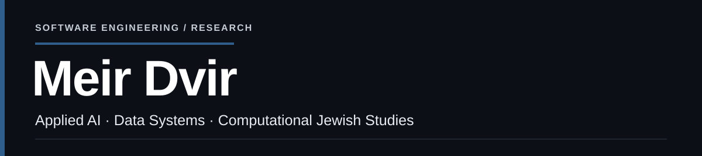

**Software developer working across data engineering, applied AI, and computational Jewish studies.**

My work sits at the intersection of reliable software and knowledge-intensive research. I build tools and explore computational methods for working with structured data, Hebrew-language material, and source-based learning. The projects below include working tools, educational resources, and research prototypes at different stages of maturity.

## Selected work

### Jewish studies, language & AI

- **[TaamAI](https://github.com/MeiRR17/TaamAI)** — A Python pipeline that aligns Torah audio transcriptions with reference texts and prepares cantillation-related audio datasets.
- **[Cantillation classification](https://github.com/MeiRR17/DeepLearning)** — An experimental PyTorch project exploring audio features, model training, and evaluation of traditional Hebrew cantillation patterns. *Research proof of concept.*
- **[Kolmud Studio](https://github.com/MeiRR17/Kolmud-Studio)** — A local-first workflow combining Hebrew speech transcription, language processing, and educational audio production. *Alpha-stage software.*

### Data engineering & developer education

- **[Data Engineering Mastery](https://github.com/MeiRR17/data-engineering-mastery)** — A structured, 14-stage practical learning path covering SQL, Python, data pipelines, validation, orchestration, reliability, and a synthetic capstone.
- **[Learning Modules](https://github.com/MeiRR17/Learning_Modules)** — Reusable programming lessons, technical guides, exercises, and consolidated developer utilities.

[Browse all public repositories](https://github.com/MeiRR17?tab=repositories)

## Research direction

My longer-term interest is in **evidence-aware knowledge systems**: software that helps people navigate complex source material while preserving provenance, context, and opportunities for human verification.

A particular area of interest is the use of **AI and computational methods in Jewish studies** — including Hebrew text and speech, textual alignment, retrieval, and new approaches to studying and communicating primary sources.

This is an ongoing research and development direction, not a claim that every envisioned system is already deployed.

## Engineering practice

I prioritise understandable architecture, reproducible workflows, explicit limitations, and evaluation grounded in evidence. Where possible, I document how a system is built, how it can be tested, and what remains unresolved.

**Technologies represented in my public work:** Python · SQL · PostgreSQL · FastAPI · PyTorch · Jupyter · Docker · Linux · GitHub Actions.

---

For technical questions or collaboration proposals, please use the issue tracker of the relevant [public repository](https://github.com/MeiRR17?tab=repositories).

<!-- The GitHub account avatar is the primary portrait; this README deliberately avoids duplicating it.
     Featured projects are public. Private systems and personal plans are not disclosed.
     The profile views badge counts service requests, not unique visitors.
-->