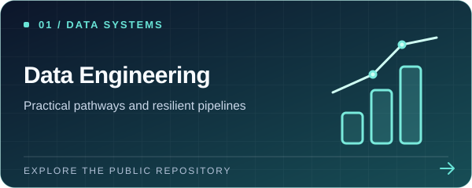
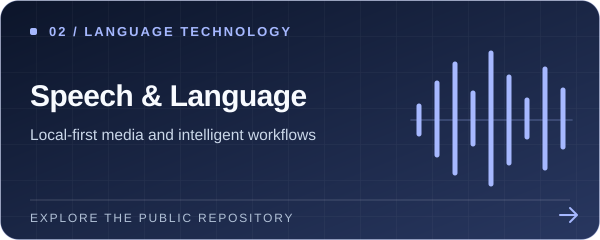
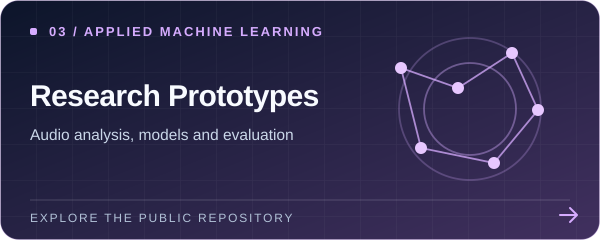
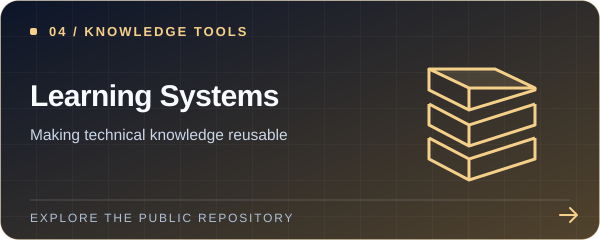
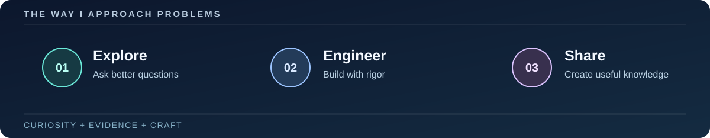

  
  
   
  
  
<strong>Curious about complex problems. Intentional about the systems built to solve them.</strong>

  
Exploring the space between software engineering, data, applied AI, and useful knowledge.

  
  

    

  
  

---

## A little about me

I'm **Meir**, a developer with a research-minded approach to building practical technology.

I enjoy connecting disciplines that are often treated separately: **reliable software**, **well-structured data**, **intelligent systems**, and **human learning**. My public repositories reflect experiments, learning resources, and software projects across these areas.

I believe good engineering is more than making something work once. It means asking the right questions, making trade-offs visible, and building systems that remain understandable, testable, and useful over time.

> **Long-term direction:** Help turn complex knowledge and emerging technology into trustworthy, accessible tools that support learning, discovery, and meaningful real-world work.

## Selected work

A few public projects that represent the kinds of questions and systems I like working on.

<table>
  <tr>
    <td width="50%" valign="top">
      
      <h3><a href="https://github.com/MeiRR17/data-engineering-mastery">Data Engineering Mastery</a></h3>
      
A hands-on learning pathway covering SQL, pipelines, orchestration, quality, reliability, and reproducible practice.

      DATA ENGINEERING · PYTHON · SQL · NOTEBOOKS
    </td>
    <td width="50%" valign="top">
      
      <h3><a href="https://github.com/MeiRR17/Kolmud-Studio">Kolmud Studio</a></h3>
      
An experimental, local-first workflow connecting speech transcription, language processing, and educational media production.

      SPEECH TECHNOLOGY · LOCAL AI · PYTHON
    </td>
  </tr>
  <tr>
    <td width="50%" valign="top">
      
      <h3><a href="https://github.com/MeiRR17/DeepLearning">Applied Deep Learning</a></h3>
      
An exploration of audio classification, feature engineering, model evaluation, and interpretable machine-learning experiments.

      PYTORCH · AUDIO ML · RESEARCH
    </td>
    <td width="50%" valign="top">
      
      <h3><a href="https://github.com/MeiRR17/Learning_Modules">Learning Modules</a></h3>
      
A public hub for reusable programming lessons, reference material, exercises, and consolidated developer utilities.

      DEVELOPER EDUCATION · APIs · TOOLING
    </td>
  </tr>
</table>

These links lead to public repositories. Some are learning-oriented, experimental, or actively evolving; their presence here is not a production-readiness claim.

## How I think about building

I gravitate toward work that combines:

- **System design & reliability** — clear architecture, observability, careful interfaces, and maintainable implementation.
- **Data & applied intelligence** — turning raw information into validated, interpretable, useful results.
- **Research & experimentation** — evidence-driven iteration, reproducible methods, and intellectual curiosity.
- **Learning & knowledge access** — making difficult concepts more understandable and technology more empowering.

## Engineering toolkit

Tools and technologies encountered in the public projects and learning materials shown here; not a claim of expertise in every item.

## Looking ahead

I'm interested in the future of **responsible intelligent software**, **knowledge-rich systems**, and **interdisciplinary research**. My goal is to keep connecting ideas to implementation: learn deeply, build carefully, evaluate honestly, and share what proves useful.

   
  <b>Build thoughtfully. Stay curious. Make knowledge useful.</b>
    
  

<!-- Visual assets are original, self-hosted SVG illustrations in ./assets/.
     Profile-view counts are third-party badge request counts, not unique visitor analytics.
     Only public, linked repositories are described; private work is deliberately excluded. -->
