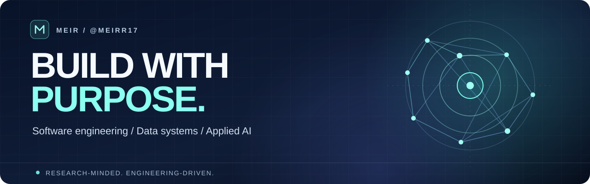
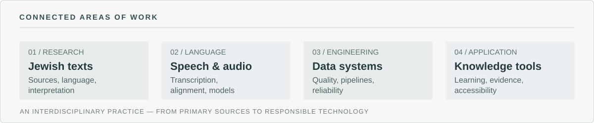

  

<table>
  <tr>
    <td width="74%" valign="middle">
      <h2>Software development, applied AI and interdisciplinary research</h2>
      
I am <strong>Meir Dvir</strong>, a software developer and independent, research-oriented builder working across data systems, artificial intelligence and computational approaches to Jewish studies.

      
My interests centre on a practical question: <em>how can rigorous research, reliable software and responsible AI make complex knowledge more accessible and useful?</em>

      
<a href="#selected-public-projects">Public projects</a> &nbsp;·&nbsp; <a href="#research-interests">Research interests</a> &nbsp;·&nbsp; <a href="#engineering-practice">Engineering practice</a>

    </td>
    <td width="26%" align="right" valign="middle">
      
    </td>
  </tr>
</table>

## Professional focus

I develop and study systems that connect **software engineering**, **data engineering**, **applied machine learning**, and **knowledge-intensive disciplines**. A distinctive part of my work explores the intersection of **Jewish textual heritage, Hebrew language technology and AI** — including speech processing, textual alignment, classification and educational applications.

I value reproducible experiments, clear sources, explicit limitations, reliable implementation and thoughtful design. My public repositories include research prototypes, working developer tools, and structured technical learning resources. I distinguish exploratory work from production software.

## Research interests

**Computational Jewish studies and AI.** Applying computational methods to Hebrew texts and recorded traditions, with an interest in provenance, interpretation, retrieval, language structure and research evaluation.

**Hebrew speech and language technology.** Exploring transcription, alignment, audio analysis and human-in-the-loop workflows for educational and research material.

**Reliable data and intelligent systems.** Designing data pipelines and software services with validation, traceability, observability and maintainable interfaces.

**Knowledge engineering and education.** Developing ways to structure, connect and communicate complex material without losing its context, sources or intellectual depth.

## Selected public projects

These repositories provide concrete examples of work in the areas above. Project maturity is stated where relevant.

| Project | Work and scope |
| :--- | :--- |
| **[TaamAI](https://github.com/MeiRR17/TaamAI)** | A Python dataset-preparation pipeline that aligns Torah audio transcription with reference text and extracts cantillation-related training segments. |
| **[Applied Deep Learning](https://github.com/MeiRR17/DeepLearning)** | A research proof of concept for classifying cantillation patterns using audio features, PyTorch and model-evaluation workflows. |
| **[Kolmud Studio](https://github.com/MeiRR17/Kolmud-Studio)** | An **alpha-stage**, local-first speech and language workflow for transforming Hebrew learning material into accessible English outputs, with transcription and speech-synthesis components. |
| **[Data Engineering Mastery](https://github.com/MeiRR17/data-engineering-mastery)** | A practical, 14-stage curriculum of SQL, Python, data pipelines, testing, orchestration, reliability, notebooks and a synthetic capstone. |
| **[Learning Modules](https://github.com/MeiRR17/Learning_Modules)** | A curated public learning hub with developer exercises, API and container guides, and reusable utility modules. |
| **[Video to Text](https://github.com/MeiRR17/Video_to_text)** | A Hebrew-focused video transcription workflow; selected portable scripts have since been consolidated into Learning Modules. |

For additional experiments and source code, see **[all public repositories](https://github.com/MeiRR17?tab=repositories)**.

## Engineering practice

| Area | Technologies and methods represented in my work |
| :--- | :--- |
| Software and APIs | Python, Java, FastAPI, REST APIs, Git |
| Data and persistence | SQL, PostgreSQL, SQLite, ETL/ELT concepts, validation |
| Machine learning | PyTorch, speech processing, audio features, model evaluation |
| Development workflow | Linux, Docker, GitHub Actions, tests, reproducible environments |
| Research and learning | Jupyter notebooks, source alignment, structured documentation |

Tools listed here appear in my public work and learning materials; the list is not intended as a claim of equal proficiency across every technology.

## Longer-term direction

I am interested in building **research-informed, evidence-aware technology** that connects primary sources, analytical methods, intelligent tools and practical applications.

The broader ambition is interdisciplinary: systems that can support sustained research, responsible knowledge discovery, technical education and useful work across domains. I see AI as a method to extend careful human reasoning — not as a substitute for source criticism, expertise or accountability.

This section describes a direction of work, not a claim that every envisioned capability has already been built.

## Connect

The most useful introduction to my work is the source itself: explore the [repositories](https://github.com/MeiRR17?tab=repositories), read the project documentation, and open an issue in a relevant public project if you have a technical question or collaboration proposal.

---

  GitHub profile activity
   
  
  

<!-- Public profile policy:
- Keep all claims linked to public work or clearly framed as interests and direction.
- No details from private repositories, personal life, internal systems, academic affiliation, unpublished findings, or employment-sensitive projects.
- The portrait image follows the account's current GitHub avatar; replace that avatar with a real professional headshot when available.
- Komarev is a third-party image-load counter, not unique human visitor analytics.
-->
