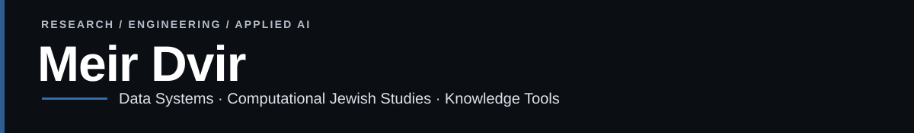
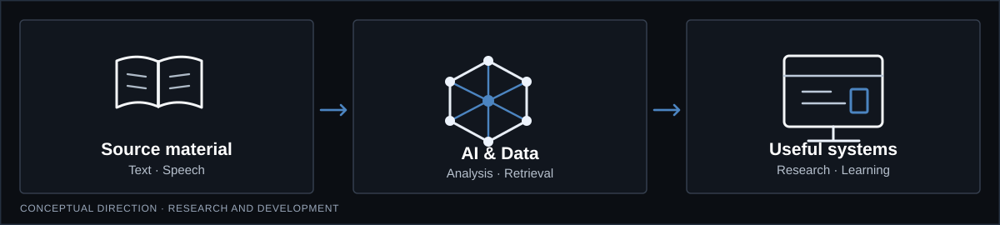

**Research-oriented software development** at the intersection of data systems, applied AI, and computational Jewish studies.

### Explore the work

| Focus | Public projects | What to expect |
| --- | --- | --- |
| **Data engineering** | [Data Engineering Mastery](https://github.com/MeiRR17/data-engineering-mastery) | Practical learning path with guided notebooks, labs, and a synthetic capstone. |
| **Computational Jewish studies** | [TaamAI](https://github.com/MeiRR17/TaamAI) · [Cantillation ML](https://github.com/MeiRR17/DeepLearning) | Hebrew-text/audio alignment and cantillation-classification experiments. |
| **Speech & language tools** | [Kolmud Studio](https://github.com/MeiRR17/Kolmud-Studio) | A local-first lecture translation and pronunciation practice prototype. |
| **Developer education** | [Learning Modules](https://github.com/MeiRR17/Learning_Modules) | Reusable tutorials and exercises for APIs, containers, and programming. |

These repositories include research prototypes, educational material, and developer tools at different stages of maturity. Check each repository's README and releases for its current status. The diagram above illustrates a direction of work, not a deployed system.

